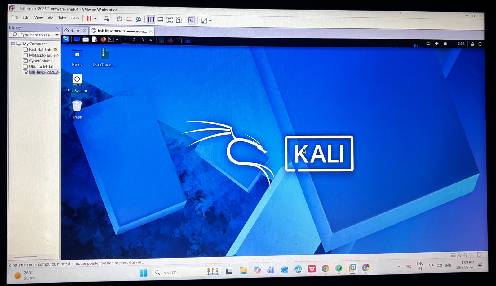
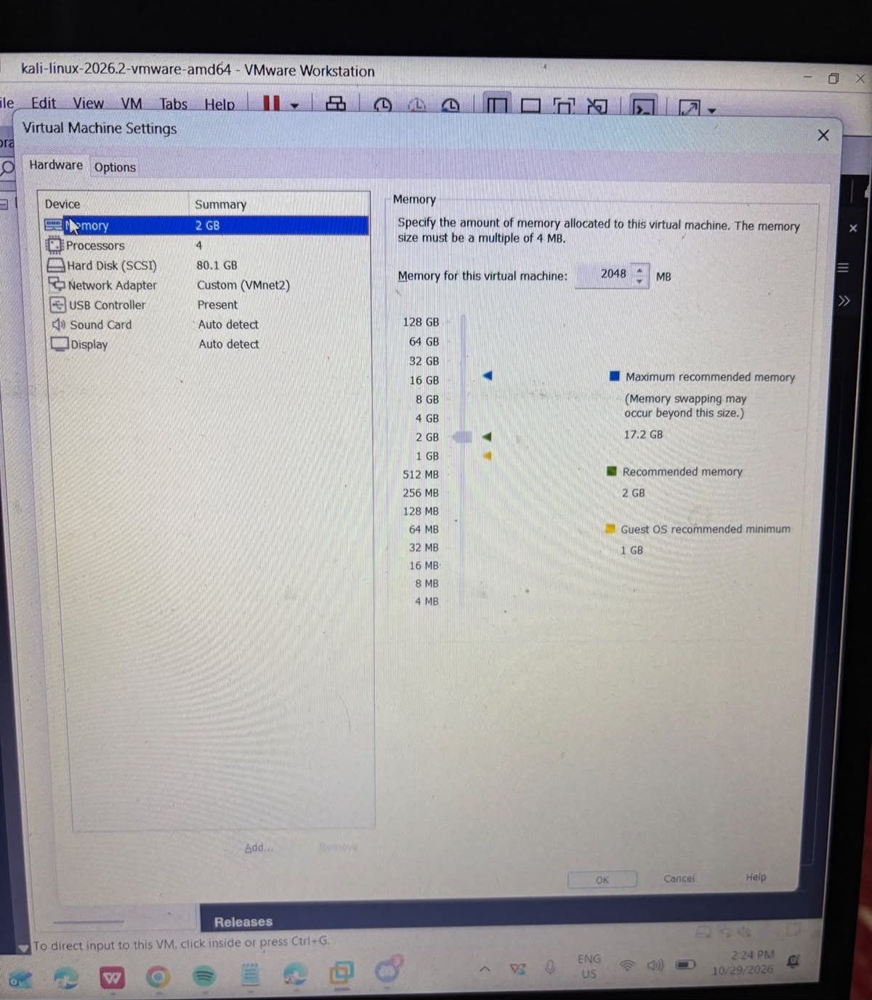
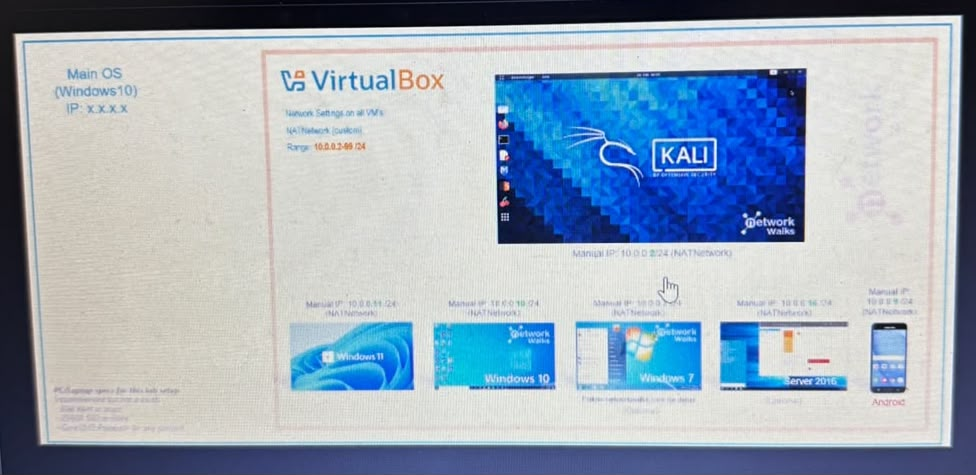
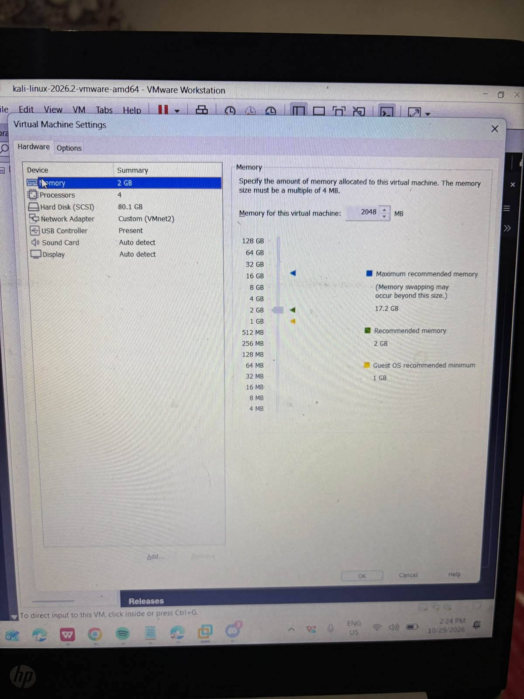

## Lab Setup Procedure

### Step 1: Prepare VMware Workstation

1. Open VMware Workstation on the host computer.
2. Select the Kali Linux virtual machine from the Library panel.
3. Power on the virtual machine.
4. Wait for Kali Linux to boot and log in if required.
5. Verify that the Kali Linux desktop loads successfully.

**Result:** The Kali Linux desktop was displayed successfully.

### Step 2: Configure the Virtual Machine

Open the virtual machine settings in VMware Workstation and review the allocated resources.

| Component | Configuration |
|---|---|
| Memory (RAM) | 2048 MB |
| Processors | 4 |
| Virtual Disk | 80.1 GB |
| Network Adapter | Custom (VMnet2) |

**Result:** The virtual machine resource settings were reviewed.

### Step 3: Verify the Operating System

Open the terminal and run:

```bash
cat /etc/os-release
hostnamectl
```

These commands display operating system and host information.

**Result:** Record the actual output to confirm the installed operating system and hostname.

### Step 4: Verify Network Configuration

#### A. Check IP Address

```bash
ip addr
```

This command displays the network interfaces and assigned IP addresses.

#### B. Check Routing

```bash
ip route
```

This command displays the routing table and default gateway, if configured.

#### C. Check DNS Configuration

```bash
cat /etc/resolv.conf
```

This command displays the configured DNS resolver entries.

#### D. Test Gateway Connectivity

Replace `<gateway-ip>` with the actual gateway address shown by `ip route`.

```bash
ping -c 4 <gateway-ip>
```

#### E. Test External Connectivity

```bash
ping -c 4 8.8.8.8
```

#### F. Test DNS Resolution

```bash
ping -c 4 google.com
```

**Result:** Record whether the gateway, external IP, and domain name tests succeeded or failed. Do not report successful connectivity unless it has been verified.

### Step 5: Capture Screenshots

Capture screenshots of:
- Kali Linux desktop
- VMware virtual machine settings
- IP address and interface output
- Routing table and connectivity test results

Save the screenshots in the `screenshots/` directory and reference them in this README.

## Screenshots

### Kali Linux Desktop


### VMware Virtual Machine Settings


### Additional Lab Screenshot


### Additional Screenshot


## Results

Kali Linux successfully starts in VMware Workstation. Network connectivity verification is pending documentation.


## Conclusion

This lab documents the initial setup of Kali Linux in VMware Workstation, the review of virtual machine resources, and the process of verifying network configuration and connectivity.

All network test results should reflect the actual lab environment.

